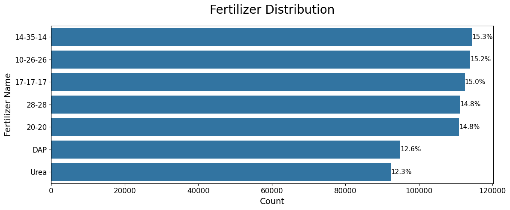
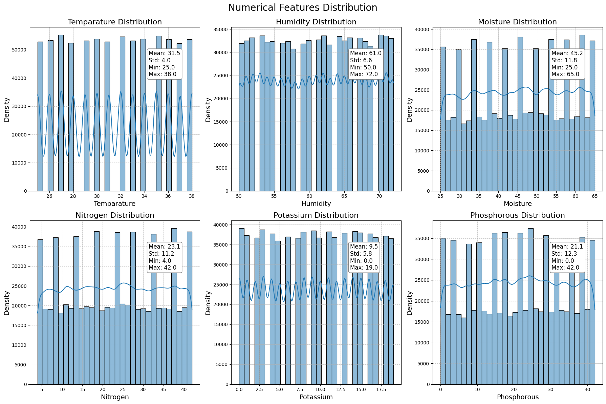
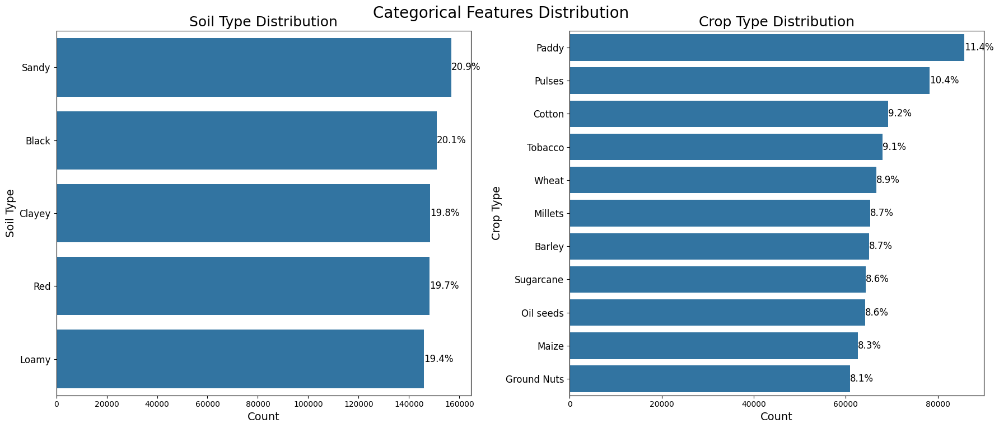
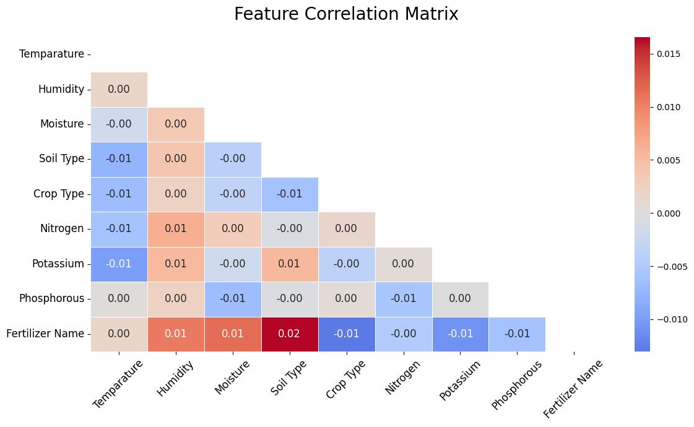

# Predicting Optimal Fertilizers: EDA and Stacked Ensemble (XGBoost + LightGBM + CatBoost)

A multi-class classification project for **Kaggle Playground Series, Season 5 Episode 6**. Given soil, crop and weather conditions, the goal is to recommend the **top 3 most suitable fertilizers** for each record. The solution stacks three gradient-boosting models (XGBoost, LightGBM, CatBoost) with a **logistic regression meta-model** and is scored with **MAP@3**.

This repository contains two notebooks:

| Notebook | Purpose |
|----------|---------|
| `ps-s5e6-eda.ipynb` | Exploratory data analysis: target balance, feature distributions, fertilizer preferences, correlations |
| `ps-s5e6-ensemble.ipynb` | Full training pipeline: data combination, 5-fold stratified CV, three base models, stacking, submission |

---

## Table of Contents

- [Overview](#overview)
- [Results](#results)
- [Dataset](#dataset)
- [Exploratory Data Analysis](#exploratory-data-analysis)
- [Preprocessing](#preprocessing)
- [Evaluation Metric: MAP@3](#evaluation-metric-map3)
- [Modeling Approach](#modeling-approach)
- [Stacking with a Meta-Model](#stacking-with-a-meta-model)
- [Submission Format](#submission-format)

---

## Overview

Choosing the right fertilizer depends on the soil, the crop and the growing conditions. This project predicts a **ranked list of three fertilizers** for each field record instead of a single label, so a near miss still earns partial credit.

**What this project does**

| Step | Description |
|------|-------------|
| 1 | Explores the data: class balance, feature distributions, crop and soil preferences, correlations |
| 2 | Combines the competition training data with an external fertilizer dataset and removes duplicates (850,000 rows) |
| 3 | Label-encodes categorical features and the 7-class target |
| 4 | Trains **XGBoost**, **LightGBM** and **CatBoost** with 5-fold stratified cross-validation |
| 5 | Collects out-of-fold (OOF) probabilities and averages test probabilities across folds |
| 6 | Trains a **logistic regression meta-model** on the stacked probabilities |
| 7 | Writes the top-3 fertilizer ranking per test row to `submission.csv` |

---

## Results

All scores are **MAP@3** (higher is better), computed on each fold's held-out validation split.

### Per-fold MAP@3

| Fold | XGBoost | LightGBM | CatBoost |
|-----:|--------:|---------:|---------:|
| 1 | 0.365876 | 0.363781 | 0.318168 |
| 2 | 0.364818 | 0.363445 | 0.317429 |
| 3 | 0.364514 | 0.363598 | 0.322527 |
| 4 | 0.364014 | 0.363632 | 0.319784 |
| 5 | 0.363640 | 0.362011 | 0.318145 |
| **Mean** | **0.364572** | **0.363293** | **0.319211** |
| Std. dev. | 0.000767 | 0.000650 | 0.001829 |

### Stacked ensemble

| Model | MAP@3 |
|-------|------:|
| CatBoost (mean of folds) | 0.319211 |
| LightGBM (mean of folds) | 0.363293 |
| XGBoost (mean of folds) | 0.364572 |
| **Logistic regression meta-model** | **0.368644** |

- The meta-model improves on the best single model (XGBoost) by about **0.0041 MAP@3 (≈ 1.1% relative)**.
- The meta-model score is measured on the **same OOF features it was trained on**, so it is slightly optimistic compared with the per-fold scores of the base models. The leaderboard score is the real test of the stack.

### Key takeaways

- **XGBoost and LightGBM are close.** Their mean scores differ by only about 0.0013, and both are very stable across folds (standard deviation below 0.001).
- **CatBoost lags by about 0.045 MAP@3** with this setup. Every feature is passed to it as categorical, including the numeric measurements, which is a likely reason.
- **Stacking adds a small but consistent gain.** The three models make different errors, and the meta-model learns how to weight their probabilities.
- **Scores are modest overall**, which fits the EDA: features are nearly uncorrelated with the target and with each other, so the signal is weak and mostly in interactions.

---

## Dataset

Source: Kaggle **Playground Series S5E6**, a synthetic dataset generated from a fertilizer recommendation dataset, plus an external *Fertilizer Prediction* dataset used to enlarge the training set.

| Item | Value |
|------|-------|
| Combined training rows (after de-duplication) | 850,000 |
| Test rows | 250,000 |
| Input features | 8 |
| Target classes | 7 |

**Features**

| Feature | Type | Description |
|---------|------|-------------|
| `Temparature` | Numeric (integer) | Air temperature, 25 to 38 (column name as spelled in the data) |
| `Humidity` | Numeric (integer) | 50 to 72 |
| `Moisture` | Numeric (integer) | 25 to 65 |
| `Soil Type` | Categorical (5) | Sandy, Black, Clayey, Red, Loamy |
| `Crop Type` | Categorical (11) | Paddy, Pulses, Cotton, Tobacco, Wheat, Millets, Barley, Sugarcane, Oil seeds, Maize, Ground Nuts |
| `Nitrogen` | Numeric (integer) | 4 to 42 |
| `Potassium` | Numeric (integer) | 0 to 19 |
| `Phosphorous` | Numeric (integer) | 0 to 42 |

**Target:** `Fertilizer Name` with 7 classes: `14-35-14`, `10-26-26`, `17-17-17`, `28-28`, `20-20`, `DAP`, `Urea`.

> The data is not redistributed in this repo. Download it from the Kaggle competition page.

---

## Exploratory Data Analysis

The EDA notebook covers target balance, numerical and categorical distributions, fertilizer preferences by crop and soil, nutrient levels per fertilizer, correlations, pairwise scatterplots and an AutoViz report.

### Target distribution

The target is **only mildly imbalanced**. Five classes sit between 14.8% and 15.3%, while `DAP` (12.6%) and `Urea` (12.3%) are slightly less common. No resampling is needed.

| Fertilizer | Share |
|------------|------:|
| 14-35-14 | 15.3% |
| 10-26-26 | 15.2% |
| 17-17-17 | 15.0% |
| 28-28 | 14.8% |
| 20-20 | 14.8% |
| DAP | 12.6% |
| Urea | 12.3% |

### Numerical features

| Feature | Mean | Std. dev. | Min | Max |
|---------|-----:|----------:|----:|----:|
| Temparature | 31.5 | 4.0 | 25 | 38 |
| Humidity | 61.0 | 6.6 | 50 | 72 |
| Moisture | 45.2 | 11.8 | 25 | 65 |
| Nitrogen | 23.1 | 11.2 | 4 | 42 |
| Potassium | 9.5 | 5.8 | 0 | 19 |
| Phosphorous | 21.1 | 12.3 | 0 | 42 |

All six features are integer-valued and look **roughly uniform** across their ranges, with no heavy skew or obvious outliers. The comb-like histograms for temperature and potassium come from binning discrete integers.

### Categorical features

- **Soil type** is nearly balanced, from Sandy (20.9%) to Loamy (19.4%).
- **Crop type** is also fairly balanced. Paddy (11.4%) and Pulses (10.4%) are the largest groups, and Ground Nuts (8.1%) the smallest.

### Correlations

After label-encoding the categorical columns, **every pairwise correlation is between about -0.01 and 0.02**, including each feature's correlation with the target. The strongest link with `Fertilizer Name` is `Soil Type` at 0.02. There is no multicollinearity to worry about, but also **no strong linear signal**, so tree-based models that capture interactions are a natural fit.

### Other analyses in the notebook

- Normalized heatmaps of fertilizer preference by crop type and by soil type
- Boxplots of nitrogen, phosphorous and potassium for each fertilizer
- Pairplot of temperature, humidity, nitrogen and phosphorous on a 1,000-row sample, coloured by fertilizer
- AutoViz automated report (150,000-row sample)

---

## Preprocessing

Implemented in the ensemble notebook:

1. Load `train.csv`, `test.csv` and the external *Fertilizer Prediction* dataset.
2. Concatenate the training and external data, then **drop duplicate rows**, giving 850,000 rows.
3. Split into features `x` and target `y`.
4. **Label-encode** the categorical feature columns (fit on training data, applied to the test data) and label-encode the 7-class target.
5. Use `StratifiedKFold` so every fold keeps the class proportions.

No additional feature engineering is applied. The models work directly on the 8 raw features.

---

## Evaluation Metric: MAP@3

**Mean Average Precision at 3** rewards putting the correct fertilizer high in a ranked list of three guesses. With one true label per row, a row scores:

| True label is ranked | Score |
|----------------------|------:|
| 1st | 1.0 |
| 2nd | 0.5 |
| 3rd | 1/3 ≈ 0.333 |
| Not in top 3 | 0 |

MAP@3 is the average of these scores over all rows. It is implemented in `map_at_3()` by taking the top 3 predicted probabilities for each row and scoring the position of the true label.

---

## Modeling Approach

Three gradient-boosting classifiers, all GPU-accelerated, are trained independently on each fold with tuned hyperparameters.

| Hyperparameter | XGBoost | LightGBM | CatBoost |
|----------------|:-------:|:--------:|:--------:|
| Objective | `multi:softprob` | `multiclass` | `MultiClass` |
| Max trees | 5000 | 10000 | 5000 |
| Learning rate | 0.1 | 0.0262 | 0.1 |
| Tree depth | 20 | 12 (`num_leaves=243`) | 5 |
| Column sampling | 0.259 | 0.437 | n/a |
| Row sampling | 0.828 | 0.799 | n/a |
| Min child weight / samples | 10 | 67 | `min_data_in_leaf=2` |
| L1 regularization | 5.62 | 6.38 | n/a |
| L2 regularization | 0.0566 | 9.39 | 0.122 |
| Early stopping | not set | 50 rounds | 50 rounds |
| Device | CUDA | GPU | GPU |

Additional notes:

- **XGBoost** uses `tree_method="hist"` with `enable_categorical=True` and `mlogloss` as the evaluation metric.
- **CatBoost** treats **all columns as categorical** (`cat_features` is the full feature list), and also uses `bagging_temperature=0.212` and `random_strength=1.886`.
- Each model produces class probabilities on its validation fold (stored as OOF predictions) and on the test set (averaged over the 5 folds).

---

## Stacking with a Meta-Model

The OOF probabilities from the three models are concatenated into a **21-feature meta-dataset** (3 models × 7 classes) with 850,000 rows.

| Setting | Value |
|---------|-------|
| Meta-model | Multinomial `LogisticRegression` |
| Solver | `lbfgs` |
| Regularization `C` | 0.1 |
| Max iterations | 2000 |
| Random state | 42 |

The meta-model is fit on the OOF features, then applied to the test-set probabilities (averaged across folds) to produce the final class probabilities. The three highest-probability classes become the prediction.

---

## Submission Format

For each test `id`, the submission lists the **top 3 fertilizers, space-separated, most likely first**:

| id | Fertilizer Name |
|----|-----------------|
| 750000 | 10-26-26 20-20 DAP |
| 750001 | 17-17-17 20-20 10-26-26 |
| 750002 | 20-20 28-28 Urea |
| 750003 | 14-35-14 10-26-26 17-17-17 |
| 750004 | 20-20 Urea 10-26-26 |

---
